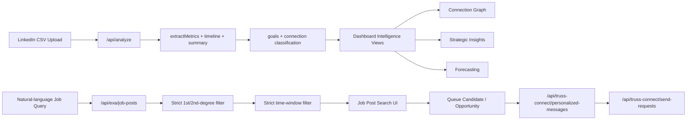

# HustlerX

HustlerX is a LinkedIn intelligence and outreach platform that combines analysis, graph exploration, AI-assisted strategy, and connection workflows into one dashboard.

It is built for one job: turn messy LinkedIn exports and live signals into actionable next moves.

## Table of Contents
1. Project Overview
2. Architecture Files (5-Page Deep Dive)
3. Visual Quick-Start Map
4. Product Surfaces
5. Key Feature Flows
6. Tech Stack
7. Local Development
8. Environment Variables
9. API Surface
10. Scripts
11. Deployment
12. Contributor Workflow
13. Release Notes Template
14. Notes and Troubleshooting

## Project Overview

HustlerX currently includes:
- LinkedIn data ingestion and analysis
- Strategic Insights and Forecasting views
- Connection Graph with up to 300 rendered nodes and interactive filters
- HustlerX Intelligence people discovery
- HustlerX Connect outreach queue and personalized AI messages
- Job Post Search with strict 1st/2nd-degree and time-aware filtering

## Architecture Files (5-Page Deep Dive)

These are the canonical architecture references for this repository.

### Page 1 of 5: System Context and Runtime Boundaries
https://mermaid.ai/d/95c40991-2b10-471a-b28c-885b6f42a000

### Page 2 of 5: Frontend Route, Component, and State Architecture
https://mermaid.ai/d/aabfe5ca-5713-4335-bdda-4859fda0bfd8

### Page 3 of 5: API Route Orchestration and Dependencies
https://mermaid.ai/d/85b07068-9f04-4f92-b2d5-7103973b3015

### Page 4 of 5: Deep Service Internals and Fallback Logic
https://mermaid.ai/d/8f6934f4-7896-4da6-8b77-597c9c8edb65

### Page 5 of 5: End-to-End Runtime Sequence
https://mermaid.ai/d/007b125f-d3ff-4def-9215-9b2a593b76fa

## Visual Quick-Start Map



Architecture first? Read the 5-page deep dive links above, then use this map as your runtime shortcut.

## Product Surfaces

- Dashboard: upload CSVs, view metrics, strategic insights, forecasting, network health
- HustlerX Intelligence: discover and queue high-fit people
- HustlerX Connect: manage outreach, LinkedIn account state, send personalized connection requests
- Job Post Search: natural-language job/internship post search with strict filters

## Key Feature Flows

### 1) LinkedIn Data Analysis
1. User uploads LinkedIn CSV exports.
2. Server parses and normalizes data.
3. Metrics, timeline, summary, goals, and classified connections are generated.
4. Dashboard modules render analysis-specific views.

### 2) Connection Graph (All Connections)
1. Classified connections are converted into graph nodes and links.
2. Up to 300 classified connections are rendered for graph performance.
3. User can filter by classification, search, company, connection year, and company-link visibility.
4. User can drag nodes and inspect profile details.

### 3) Job Post Search
1. User enters a human-language query.
2. API searches LinkedIn job/hiring posts via EXA.
3. Strict 1st/2nd-degree filter is applied.
4. If time phrases are present (for example: within 24 hours), strict freshness filtering is applied.
5. UI returns filtered posts with transparency counters.

### 4) Truss Connect Outreach
1. User queues candidates from Truss Intelligence.
2. Personalized messages are generated per candidate (AI with fallback mode).
3. User edits messages and sends requests.
4. Daily quotas, send logs, and statuses are tracked.

## Tech Stack

- Framework: Next.js 16 (App Router)
- UI: React 19, Tailwind CSS, Lucide icons, Motion
- Data and Auth: Supabase (SSR + admin access)
- Search and intelligence: EXA
- LLM features: OpenRouter-backed calls
- Integrations: Unipile (LinkedIn account and request workflows)
- Charts and visualizations: Recharts

## Local Development

### Prerequisites
- Node.js 18+
- npm
- Supabase project (or configured environment)

### Setup
1. Install dependencies:

```bash
npm install
```

2. Create a local env file:

```bash
cp .env.example .env.local
```

If `.env.example` is not present, create `.env.local` manually with the variables in the Environment Variables section below.

3. Start dev server:

```bash
npm run dev
```

4. Open:

```text
http://localhost:3000
```

## Environment Variables

### Core
- `NEXT_PUBLIC_SUPABASE_URL`
- `NEXT_PUBLIC_SUPABASE_ANON_KEY`
- `SUPABASE_SERVICE_ROLE_KEY`

### Search and LLM
- `EXA_API_KEY`
- `OPENROUTER_API_KEY`
- `OPENROUTER_CHAT_MODEL` (optional)
- `OPENROUTER_ANALYSIS_MODEL` (optional)
- `OPENROUTER_TRUSS_CONNECT_MODEL` (optional)

### App URL/origin helpers
- `NEXT_PUBLIC_APP_URL` (recommended)
- `NEXT_PUBLIC_SITE_URL` (optional)
- `ORIGIN` (optional)

### Unipile
- `UNIPILE_API_KEY`
- `UNIPILE_DSN` (or one of these alternatives)
- `UNIPILE_BASE_URL`
- `UNIPILE_API_URL`
- `UNIPILE_ACCOUNTS_URL`
- `TRUSS_CONNECT_ALLOW_MOCK` (optional)

## API Surface

### Analysis and chat
- `POST /api/analyze`
- `GET /api/analyze?query=...`
- `POST /api/chat`

### EXA routes
- `POST /api/exa/search`
- `POST /api/exa/neural`
- `POST /api/exa/people`
- `POST /api/exa/job-posts`

### Truss Connect
- `GET /api/truss-connect/account-status`
- `POST /api/truss-connect/personalized-messages`
- `POST /api/truss-connect/send-requests`

### Unipile and user state
- `POST /api/unipile/hosted-link`
- `POST /api/unipile/notify`
- `GET/PUT /api/user/page-state`

## Scripts

```bash
npm run dev          # Start local development server
npm run build        # Production build
npm run start        # Run built app
npm run lint         # Lint JS/TS files
npm run db:clean:dry # Preview database cleanup
npm run db:clean     # Apply database cleanup
```

## Deployment

Production is typically deployed on Vercel.

### Quick deploy
```bash
npx vercel --prod --yes
```

After deployment, validate key routes:
- `/dashboard`
- `/dashboard/job-post-search`

## Contributor Workflow

### Branch Naming
- `feat/<short-feature-name>`
- `fix/<short-bug-name>`
- `docs/<short-doc-change>`
- `refactor/<short-scope>`

### Commit Style (recommended)
- `feat: add strict time parsing for job search`
- `fix: correct activity classification for likes`
- `docs: expand architecture section in README`

### Pull Request Checklist
1. Scope is focused and avoids unrelated refactors.
2. Build succeeds locally (`npm run build`).
3. Lint is clean for changed files.
4. Any route/API behavior changes are documented in this README.
5. Deploy verification includes critical routes and feature path checks.

### Definition of Done
- Feature works in production path, not only locally.
- Error and fallback behavior is explicit.
- Runtime assumptions are documented (auth, env vars, provider limits).

## Release Notes Template

Use this template for each release cycle.

```md
## [vX.Y.Z] - YYYY-MM-DD

### Added
-

### Changed
-

### Fixed
-

### Performance
-

### Security
-

### Migrations / Config
-

### Validation
- Build: pass/fail
- Targeted lint: pass/fail
- Production smoke checks: pass/fail

### Known Issues
-
```

### Current Architecture Reference Pack
- Page 1: System Context and Runtime Boundaries
- Page 2: Frontend Route, Component, and State Architecture
- Page 3: API Route Orchestration and Dependencies
- Page 4: Deep Service Internals and Fallback Logic
- Page 5: End-to-End Runtime Sequence

## Notes and Troubleshooting

- If metrics look stale, re-upload CSVs to trigger a fresh analysis.
- If Job Post Search returns no results, broaden the query and time window.
- If strict time filtering is active, posts with missing publish timestamps can be excluded.
- If Truss Connect is disconnected, refresh account status and verify Unipile configuration.
- If environment variables are missing, API routes can fail with configuration errors.

---

If you are onboarding to this codebase, start with the 5 architecture pages first, then walk through `src/app/dashboard` and `src/app/api` route implementations.

